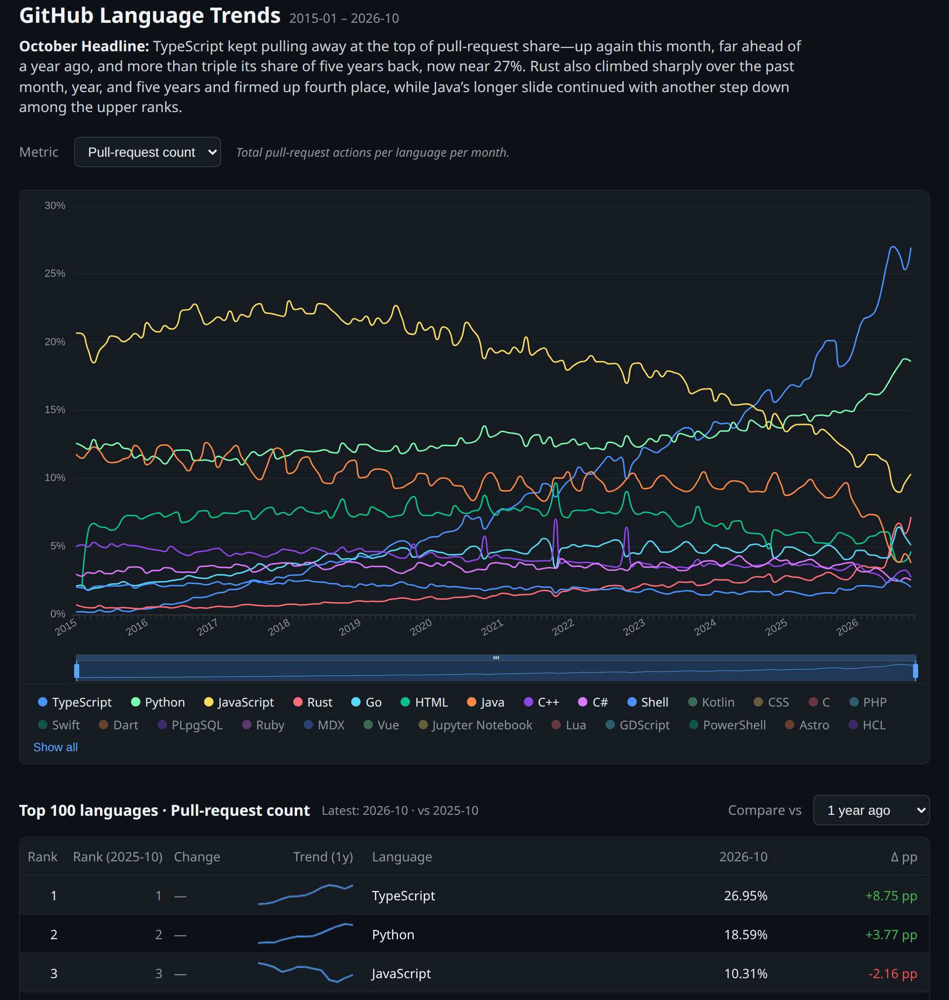

# GitHub Language Trends

[](https://guenhter.github.io/githubstats/)
[](LICENSE)

**[View live site →](https://guenhter.github.io/githubstats/)**

**githubstats** — monthly programming-language popularity from real GitHub activity, spanning January 2015 through the present.
Events come from [GH Archive](https://www.gharchive.org/); bots and automation are filtered out; languages are resolved from the GitHub GraphQL API by byte share, not a single primary-language field.
Explore the interactive chart and ranked table across five activity metrics: pull requests, pushes, issues, active repos, and stars.

[](https://guenhter.github.io/githubstats/)

## Try it

Open the **[live site](https://guenhter.github.io/githubstats/)**, or serve the repo locally (not `file://` — the browser needs HTTP for `fetch` and the ECharts CDN):

```bash
python3 -m http.server 8080 --directory .
```

Then open http://localhost:8080/index.html.

## How it works

For each repository with language breakdown `{L: size_L}` and total codebase size `total_size`, event counts are distributed by byte share:

```
rating[L] += event_count × (size_L / total_size)
```

Example: a repo with 2 PRs that is 70% TypeScript / 30% Python contributes **1.4** to TypeScript and **0.6** to Python.

Five signals use that weighting (or a unit weight for breadth):

| Metric | Signal |
| --- | --- |
| `pr-count` | Pull-request volume |
| `issue-count` | Issue volume |
| `push-count` | Push volume |
| `active-repos` | Distinct active repos (breadth, not volume) |
| `star-count` | Stars (WatchEvents) |

More detail: [`docs/LANGUAGE_DATA.md`](docs/LANGUAGE_DATA.md) (language attribution), [`docs/PIPELINE.md`](docs/PIPELINE.md) (tools, runbook, rating file formats), [`docs/HEADLINE.md`](docs/HEADLINE.md) (monthly headline rules).
